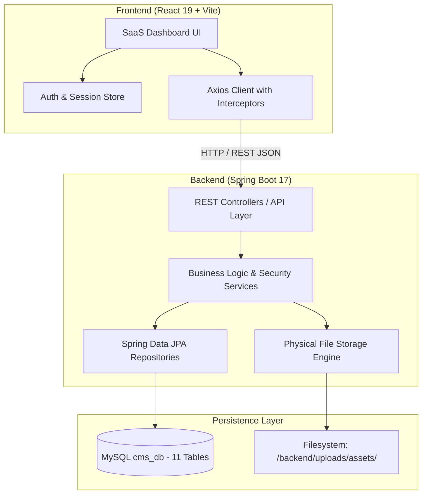

# Content Management System (CMS) — Full-Stack Web Application

[](https://www.oracle.com/java/)
[](https://spring.io/projects/spring-boot)
[](https://react.dev/)
[](https://vitejs.dev/)
[](https://www.mysql.com/)

> **Academic Project Submission**  
> **Course**: Master of Computer Applications (MCA) — 2nd Year  
> **Institution**: ABES Engineering College  
> **Subject**: Full Stack Java Development  

---

## 1. Executive Summary

The **Content Management System (CMS)** is an enterprise-grade full-stack web application designed for marketing, publishing, and digital media teams to securely ingest, classify, store, version, govern, and distribute digital media assets (images, videos, audio, and documents).

Built upon a decoupled architecture with **Spring Boot REST APIs**, **Spring Data JPA / Hibernate**, a **MySQL relational database**, and a modern **React 19 + Vite** single-page frontend, the system enforces strict Role-Based Access Control (RBAC), physical disk storage with path traversal protection, automated revision tracking, and an immutable audit trail.

---

## 2. Architecture & Design

### Technology Stack
* **Frontend**: React 19, JavaScript (ES6+), Vite 8, Axios, CSS3 (Modern SaaS Design System, Flexbox, CSS Grid).
* **Backend**: Java 17, Spring Boot, Spring Web (REST Controllers), Spring Data JPA, Hibernate, Maven.
* **Database**: MySQL 8/9 (`cms_db`), InnoDB engine, foreign keys, cascade safety, custom indexes.
* **Security & Cryptography**: BCrypt hashing (`org.mindrot:jbcrypt`), legacy SHA-256 transparent upgrade, Token/Session authentication, User status enforcement (`ACTIVE` vs `INACTIVE`).
* **Storage Engine**: `FileStorageService` with configurable upload directory (`backend/uploads/assets/`), UUID-based collision avoidance, and 50MB file size safety ceiling.

### Architecture Overview



---

## 3. Implemented Modules & Capabilities

### A. Authentication & Access Control (RBAC)
- **Email & Password Login**: Validates credentials against salted BCrypt hashes. Supports backward-compatible SHA-256 verification with automatic on-login hash upgrades.
- **Account Status Verification**: Rejects `INACTIVE` accounts with `403 Forbidden` ("Your account is inactive. Please contact your system administrator.").
- **Session Management**: Issues authentication tokens with user context, role, and granted authority permissions.
- **Frontend Protection**: Persistent authentication state in `localStorage`, dynamic navigation based on roles, secure logout endpoint logging user session termination.

### B. Interactive Dashboard
- **Live Database Metrics**: Real-time asset count breakdown (`Total`, `Published`, `Drafts`, `Archived`), category count, tag count, and total active users.
- **Recent Assets Feed**: Displays the 5 most recently created or uploaded assets with live file formats, sizes, and direct links.
- **Live Audit Feed**: Stream of recent system events (user logins, uploads, metadata updates, status changes).
- **Quick Action Links**: 1-click shortcuts to Upload Asset, Asset Library, Categories, and User Management.

### C. Digital Asset Library
- **Comprehensive View**: Toggle between responsive Grid cards and high-density tabular List views.
- **Multi-parameter Filtering**: Instant search by asset title/description, filter by Category, Asset Type (`IMAGE`, `VIDEO`, `AUDIO`), and Publication Status (`DRAFT`, `PUBLISHED`, `ARCHIVED`).
- **Dynamic Sorting**: Sort by Newest, Oldest, Title (A-Z / Z-A), and File Size.
- **Asset Detail Modal**: In-depth inspection popup displaying embedded media players (image viewer, HTML5 video player, audio stream), physical file metadata, creation/update timestamps, and associated tags.
- **File Download**: Direct binary streaming via `GET /api/assets/{id}/download` with proper `Content-Disposition` headers and original filenames.
- **Safe Deletion**: Two-step deletion dialog preventing accidental removal of media.

### D. Physical File Upload & Asset Ingestion
- **Multipart Upload**: `POST /api/assets/upload` handles binary files up to 50 MB with metadata payload.
- **Instant Client Preview**: Local `URL.createObjectURL` thumbnail rendering before upload.
- **Auto-detection**: Automatically extracts MIME types, formatted byte sizes, and pre-populates asset titles from filenames.
- **Revision & Audit Trigger**: Physical upload automatically seeds version `1.0` in `asset_versions` and records an `ASSET_UPLOAD` event in `activity_logs`.

### E. Category & Tag Taxonomies
- **Categories**: Full CRUD with real-time `assetCount` aggregation. Built-in dependency protection blocks deleting categories that contain active assets (`409 Conflict`).
- **Tags**: Full CRUD with real-time `usageCount` aggregation across all assets.

### F. User & Role Management
- **User CRUD**: Create users with BCrypt password generation, update profile details, and assign system roles (`ADMIN`, `CONTENT_PRODUCER`, `CONTENT_MANAGER`).
- **One-Click Status Toggle**: Instantly toggle user status between `ACTIVE` and `INACTIVE` with audit logging.
- **Roles & Permissions Matrix**: Interactive view of system permissions grouped by functional modules (`Assets`, `Categories`, `Tags`, `Users`, `Roles`).

### G. Version History & Audit Trail
- **Version History**: Chronological log of all asset revisions (`v1.0`, `v1.1`), original uploader identity, file size changes, and revision notes.
- **Activity Logs**: System-wide event audit log capturing action timestamps, acting user, target entity (`ASSET`, `USER`, `CATEGORY`, `AUTH`), and operation descriptions.

---

## 4. Database Schema (`cms_db`)

The database consists of **11 relational tables** with referential integrity constraints:

| Table Name | Description | Key Foreign Keys & Constraints |
| :--- | :--- | :--- |
| `roles` | System roles (`ADMIN`, `CONTENT_PRODUCER`, `CONTENT_MANAGER`) | Primary key: `role_id` |
| `users` | User accounts with email, hashed passwords, status | FK `role_id` -> `roles.role_id`, Unique `email` |
| `permissions` | Granular permission identifiers | Primary key: `permission_id`, Unique `name` |
| `role_permissions` | Many-to-Many mapping of roles to permissions | Composite PK (`role_id`, `permission_id`) |
| `categories` | Organizational categories for assets | Primary key: `category_id`, Unique `category_name` |
| `tags` | Searchable keywords | Primary key: `tag_id`, Unique `tag_name` |
| `assets` | Core media asset metadata and file paths | FK `category_id`, FK `created_by` -> `users.user_id` |
| `asset_tags` | Many-to-Many mapping of assets to tags | Composite PK (`asset_id`, `tag_id`) |
| `asset_versions` | Revisions, change logs, and prior file paths | FK `asset_id`, FK `uploaded_by` -> `users.user_id` |
| `activity_logs` | Immutable audit trail of system events | FK `user_id` -> `users.user_id` |
| `asset_permissions` | Individual user permissions on assets | FK `asset_id`, FK `user_id`, FK `permission_id` |

---

## 5. Setup & Running Instructions

### Prerequisites
* **Java**: JDK 17 or higher (`java -version`)
* **Maven**: Version 3.8+ (`mvn -version`)
* **Node.js**: Node 20+ / Node 24 (`node -v`)
* **MySQL**: Server 8.0 or 9.0 running on `localhost:3306`

---

### Step 1: Database Initialization
1. Start your local MySQL service.
2. Log into MySQL Workbench or MySQL CLI:
   ```bash
   mysql -u root -p
   ```
3. Run the schema creation script:
   ```sql
   CREATE DATABASE IF NOT EXISTS cms_db;
   USE cms_db;
   ```
4. Execute `backend/src/main/resources/schema.sql` (or import from `docs/Database_Design.md`).
5. Verify database credentials in `backend/src/main/resources/application.properties`:
   ```properties
   spring.datasource.url=jdbc:mysql://localhost:3306/cms_db?useSSL=false&serverTimezone=UTC&allowPublicKeyRetrieval=true
   spring.datasource.username=root
   spring.datasource.password=YOUR_MYSQL_PASSWORD
   ```

---

### Step 2: Backend Execution
1. Navigate to the `backend` folder:
   ```bash
   cd backend
   ```
2. Build the project using Maven:
   ```bash
   mvn clean package -DskipTests
   ```
3. Start the Spring Boot application:
   ```bash
   mvn spring-boot:run
   ```
   *The backend will boot on port `8080`. Physical file uploads will be stored in `backend/uploads/assets/`.*

---

### Step 3: Frontend Execution
1. Open a new terminal and navigate to the `frontend` folder:
   ```bash
   cd frontend
   ```
2. Install dependencies:
   ```bash
   npm install
   ```
3. Start the development server:
   ```bash
   npm run dev
   ```
4. Open your browser and navigate to:
   ```
   http://localhost:5173/
   ```

---

## 6. Pre-seeded Demo Accounts

For testing and demonstration, use the pre-configured accounts:

| Role | Email Address | Password | Status | Intended Capabilities |
| :--- | :--- | :--- | :--- | :--- |
| **Administrator** | `admin@cms.com` | `CMS_DEMO_PASSWORD` | `ACTIVE` | Full unrestricted access (User management, system roles, asset CRUD, categories, tags, versioning). |
| **Content Producer** | `ananya@cms.com` | `CMS_DEMO_PASSWORD` | `ACTIVE` | Upload assets, manage own media, edit drafts, view categories. |
| **Content Manager** | `rohan@cms.com` | `CMS_DEMO_PASSWORD` | `ACTIVE` | Review drafts, publish/archive assets, manage categories and tags. |
| **Inactive Test User** | `aditya@cms.com` | `CMS_DEMO_PASSWORD` | `INACTIVE` | Used to verify authentication security; login attempt is strictly rejected with `403 Forbidden`. |

*(Note: The login screen also includes convenient quick-fill demo buttons for instant access.)*

---

## 7. REST API Catalog

All endpoints are hosted under `http://localhost:8080/api`:

### Authentication & Dashboard
- `POST /api/auth/login` — Authenticate credentials, verify status, return token & user context.
- `POST /api/auth/logout` — Invalidate user session and log audit event.
- `GET /api/dashboard/stats` — Return live counts (total, published, drafts, archived, categories, users) and recent feeds.

### Asset Management
- `GET /api/assets` — Retrieve list of assets with optional search & filter params.
- `GET /api/assets/{id}` — Fetch full metadata and tags for a single asset.
- `POST /api/assets/upload` — Multipart file upload (`file` + `asset` JSON).
- `PUT /api/assets/{id}` — Update asset metadata, tags, and category.
- `DELETE /api/assets/{id}` — Remove asset and clean associated tags.
- `GET /api/assets/{id}/preview` — Stream binary media (inline display).
- `GET /api/assets/{id}/download` — Download original binary file (`attachment`).

### Taxonomies & Administration
- `GET /api/categories` — List all categories with live `assetCount`.
- `POST /api/categories` — Create a new category.
- `PUT /api/categories/{id}` — Update category name and description.
- `DELETE /api/categories/{id}` — Delete category (returns `409 Conflict` if assets are assigned).
- `GET /api/tags` — List all tags with `usageCount`.
- `POST /api/tags` — Create a new tag.
- `DELETE /api/tags/{id}` — Delete tag.
- `GET /api/users` — List all users with role details.
- `POST /api/users` — Create user with BCrypt hashed password.
- `PUT /api/users/{id}` — Update user profile and role.
- `PATCH /api/users/{id}/status` — Toggle user `ACTIVE`/`INACTIVE` status.
- `DELETE /api/users/{id}` — Delete user account.
- `GET /api/roles` — List system roles and associated permissions.
- `GET /api/versions` — Retrieve asset revision history.
- `GET /api/activities` — Retrieve system audit activity logs.

---

## 8. Viva Voce Preparation Guide (For MCA Evaluators)

### Q1: How does the system handle password security?
> **Answer**: Passwords are never stored in plaintext. The application utilizes the industry-standard **BCrypt** adaptive hashing algorithm with 10 salt rounds (`org.mindrot:jbcrypt`). Additionally, our `PasswordUtil` implementation supports automatic transparent migration: when users with legacy SHA-256 hashes log in, their credentials are authenticated and immediately re-hashed to BCrypt in the MySQL database. Furthermore, user entities annotate `passwordHash` with `@JsonIgnore` to prevent sensitive exposure over REST responses.

### Q2: How is physical file upload implemented and separated from metadata?
> **Answer**: Uploads use `MultipartHttpServletRequest` via `POST /api/assets/upload`. The `FileStorageService` stores the binary stream on the host filesystem under `backend/uploads/assets/` using a generated UUID filename to prevent naming collisions and sanitizes input to prevent path traversal attacks. In parallel, metadata (original filename, MIME type, file size in bytes, status, creator user ID) is persisted in the `assets` table. A download URL (`/api/assets/{id}/download`) and preview URL (`/api/assets/{id}/preview`) are exposed to stream the binary safely to the client.

### Q3: How is referential integrity protected during deletions?
> **Answer**: In `CategoryService`, before deleting a category record, a database query checks `assetRepository.findByCategory(category)`. If any assets remain associated with that category, the deletion is rejected with `409 Conflict` and a descriptive message advising the admin to reassign or delete the assets first. Similarly, tag associations in `asset_tags` are decoupled gracefully.

### Q4: How is Role-Based Access Control (RBAC) structured in the database?
> **Answer**: The database uses a normalized 4-tier model: `users` have a foreign key to `roles`. `roles` are mapped to `permissions` through a junction table `role_permissions`. At login, Spring Boot loads the user's role and traverses `role.getPermissions()` to return an array of granted authorities (`ASSET_CREATE`, `USER_MANAGE`, etc.), allowing both backend validation and dynamic UI component visibility.

---

## 9. Project Contributors
* **Student Name**: Divya Aggarwal  
* **Program**: MCA, 2nd Year  
* **Institution**: ABES Engineering College  
* **Department**: Department of Computer Applications  
